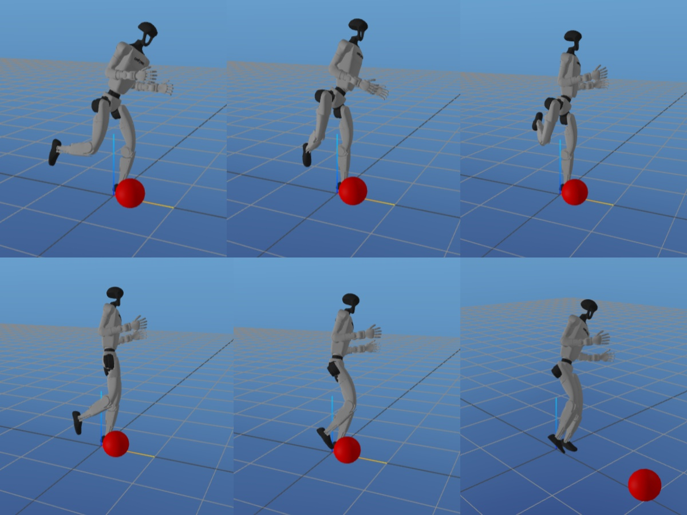

# Unitree G1 Humanoid ball Kicking

This project was completed as part of the [Optimal Control and Reinforcement Learning](https://optimalcontrol.ri.cmu.edu/) course at Carnegie Mellon University. We worked on generating and executing an optimal kicking motion for a Unitree G1 Humanoid.

**Goal: Kick a ball toward a target while maintaining balance before and after impact.**

- Trajectory Optimization:
    - Formulated a Quadratic Program (QP) to determine the required impulse and contact position of the foot.

    - Generated an initial trajectory guess via naive interpolation.

    - Refined the solution using Direct Collocation to obtain the optimal kicking trajectory.

- Control Strategy:

    - Infinite-Horizon LQR (IHLQR) used for balancing the humanoid both before and after the kick.
    - Time-Varying LQR (TVLQR) applied for trajectory tracking during the kicking motion.

### Videos
- [Full Speed](https://drive.google.com/file/d/1FhlD4hPu-XXpK32L3f2H4Rv3OroUKuA2/view?usp=sharing)
- [Slow Motion](https://drive.google.com/file/d/1EilVrnmoFSmlJsimRPYWn9uKhdSVe0lE/view?usp=sharing) (1/10 Speed)

### Report
[Google drive](https://drive.google.com/file/d/1baNCbEeNHYRVjI_QtZgY7OsL3DrSKAbi/view?usp=sharing)